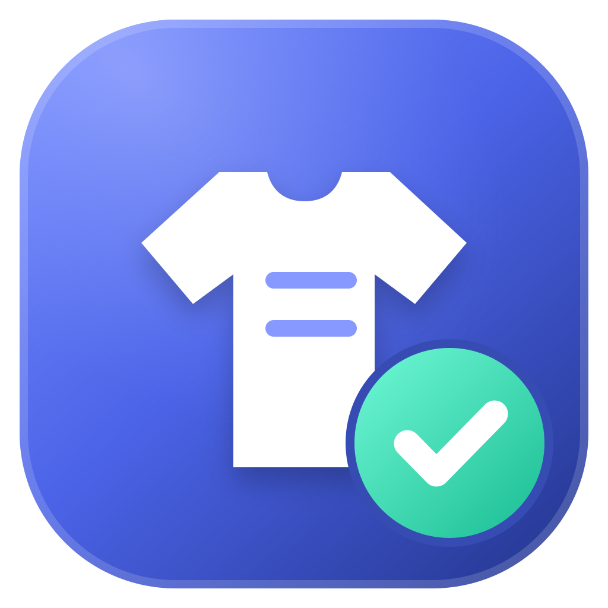
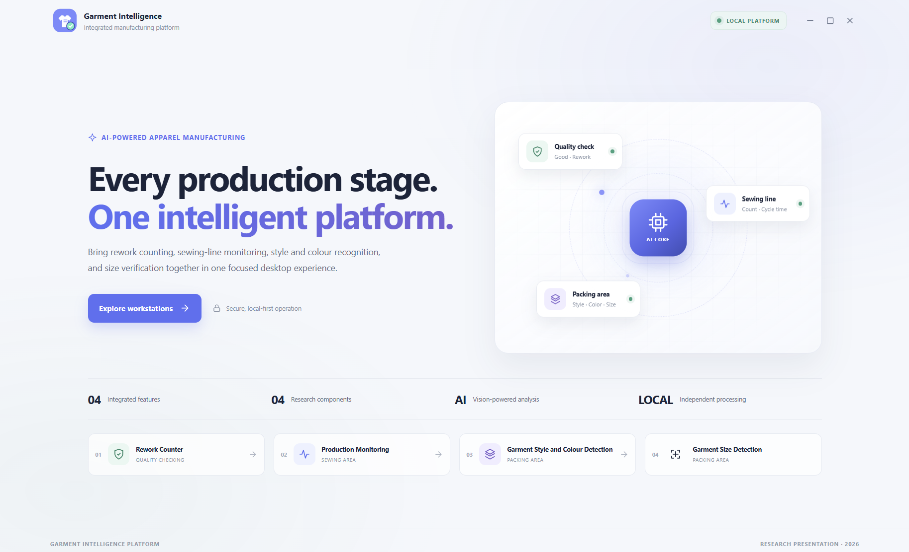
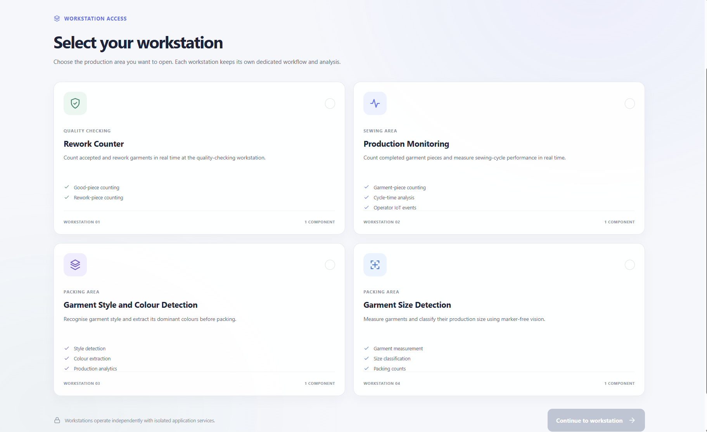
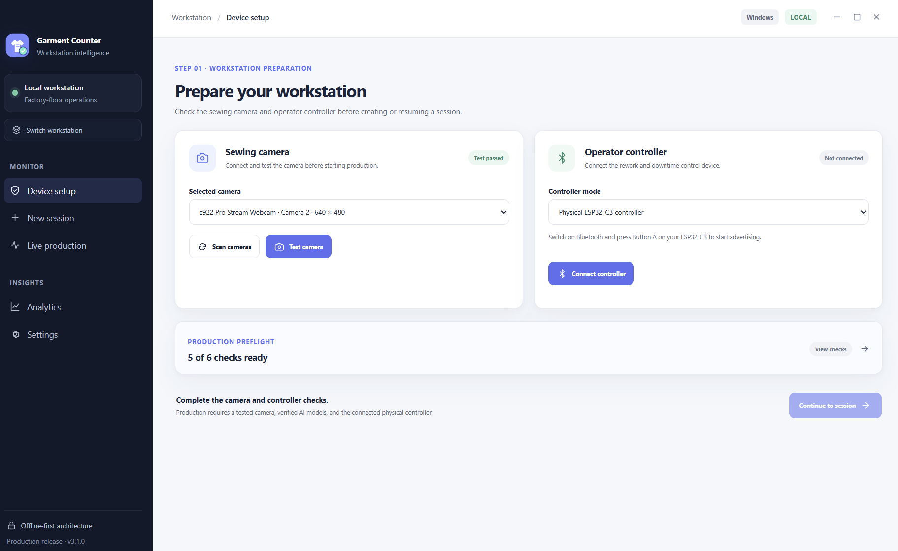
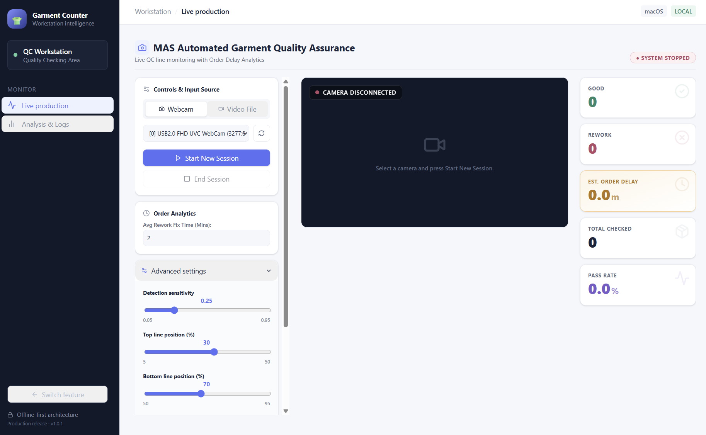
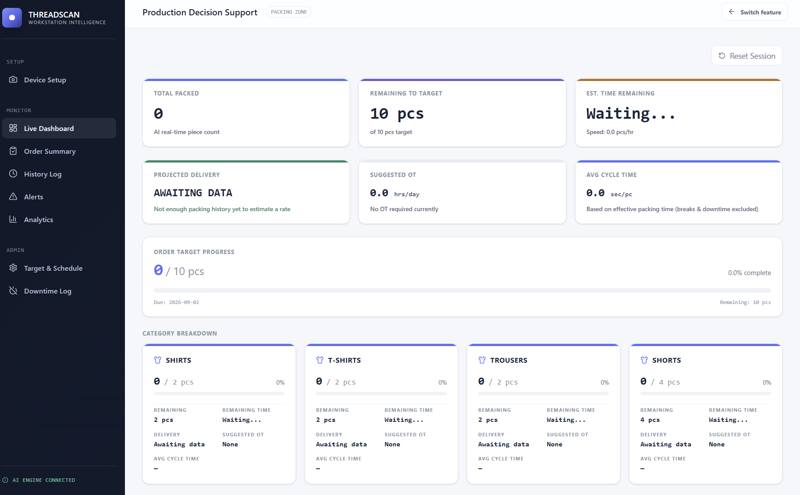
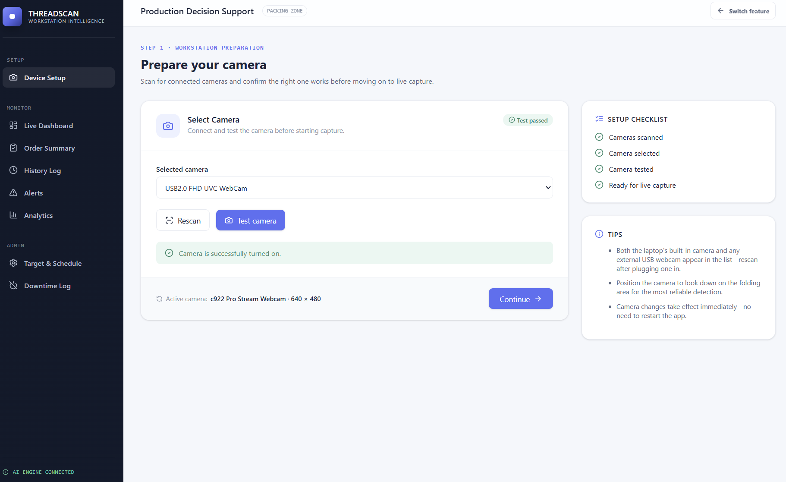
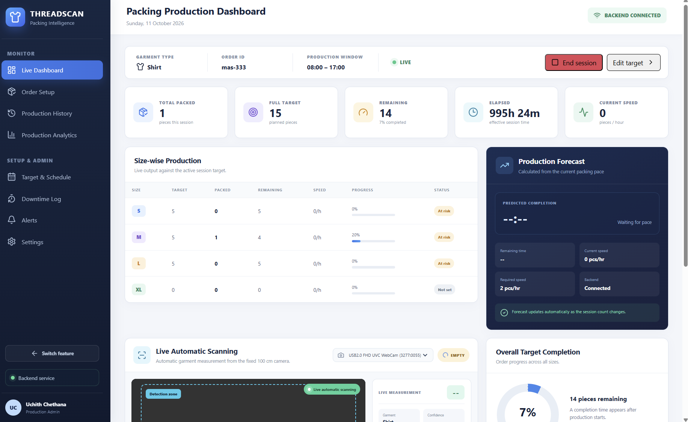
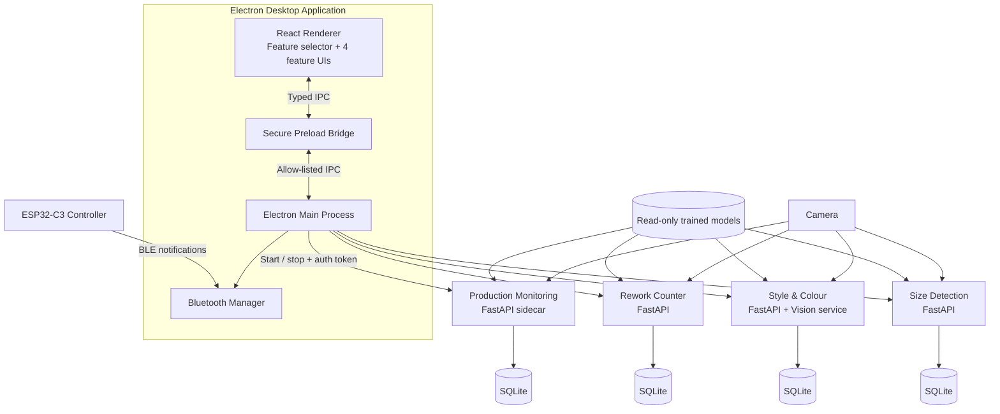

<p align="center">
  
</p>

# Garment Intelligence Platform

**Research Project ID:** R-26-IT-054 &nbsp;·&nbsp; **Version:** 3.1.0

An AI-powered desktop platform for garment manufacturing. It brings four independently developed computer-vision research components together into **one Electron desktop application**, while each component keeps its own frontend, backend, trained model and database.


<p align="center">
  
</p>

---

## Table of contents

- [Overview](#overview)
- [Research components](#research-components)
- [Screenshots](#screenshots)
- [System architecture](#system-architecture)
- [Technology stack](#technology-stack)
- [Repository structure](#repository-structure)
- [Getting started](#getting-started)
- [Verification and testing](#verification-and-testing)
- [Production build](#production-build)
- [IoT hardware](#iot-hardware)
- [Operating notes](#operating-notes)
- [Documentation](#documentation)
- [Team](#team)

---

## Overview

Garment factories still rely heavily on manual counting, visual inspection and manual measurement. These processes are slow, error-prone and give supervisors little real-time insight into the production line.

Garment Intelligence addresses this with camera-based AI and an IoT controller at the workstation. When the app opens, the operator picks one of four feature cards. Electron starts only the backend service that feature needs, and switching features safely stops the outgoing camera or session first.

<p align="center">
  <br>
  <sub><i>Workstation selection: each component runs as an isolated workstation.</i></sub>
</p>

## Research components

| ID | Component | What it does | Key techniques |
|---|---|---|---|
| C1 | **Production Monitoring** | Vision-based garment piece counting and sewing cycle time measurement. Integrates an ESP32-C3 Bluetooth controller for rework, downtime and reset events. | YOLOv8n workstation detection, 8-frame temporal MobileNetV3 activity classification (`SEWING` / `IDLE_SETUP`), BLE, Excel export |
| C2 | **Rework Counter** | Real-time good and rework counting at the quality checking workstation, with inspection history. | YOLO (Ultralytics), OpenCV |
| C3 | **Garment Style & Colour Detection** | Recognises garment style and extracts dominant colours, with production decision support through analytics, downtime logs and order summaries. | YOLO style inference, dominant-colour extraction, FastAPI + Flask vision service |
| C4 | **Garment Size Detection** | Real-time best frame selection and marker-free size measurement, with size recommendation against a size chart and SQLite-backed orders. | YOLO-based measurement, best-frame selection, camera calibration, size-chart rules |

The four backends **never call each other**. This keeps clear authorship for each research member and prevents one feature from reading another feature's data.

## Screenshots

<table>
  <tr>
    <td align="center" width="50%">
      <br>
      <b>C1 · Production Monitoring</b><br>
      <sub>Workstation setup: sewing camera and ESP32-C3 operator controller</sub>
    </td>
    <td align="center" width="50%">
      <br>
      <b>C2 · Rework Counter</b><br>
      <sub>Live QC monitoring: good, rework, pass rate and order delay</sub>
    </td>
  </tr>
  <tr>
    <td align="center" width="50%">
      <br>
      <b>C3 · Garment Style &amp; Colour Detection</b><br>
      <sub>Production decision support: target progress, suggested OT, category breakdown</sub>
    </td>
    <td align="center" width="50%">
      <br>
      <b>C3 · Camera Setup</b><br>
      <sub>Workstation preparation: camera scan, selection and test</sub>
    </td>
  </tr>
  <tr>
    <td align="center" colspan="2">
      <br>
      <b>C4 · Garment Size Detection</b><br>
      <sub>Packing production dashboard: size-wise output, production forecast and live automatic scanning</sub>
    </td>
  </tr>
</table>

## System architecture



**Security boundary**

- The React renderer has no direct Node.js access. It only calls the named methods exposed on `window.garmentDesktop`.
- The Electron main process allow-lists every API route before forwarding it to a loopback (`127.0.0.1`) service.
- Each launch generates a bearer token that never reaches renderer code. Live video streams go through custom Electron protocols for the same reason.
- Trained models ship read-only. Writable databases live under Electron's user-data folder, so an app update cannot overwrite research results.

## Technology stack

| Layer | Technologies |
|---|---|
| Desktop shell | Electron 43, Electron Forge, Webpack |
| Frontend | React 19, TypeScript, Tailwind CSS 4, Radix UI / shadcn, Zustand, Chart.js, Recharts |
| Backend | Python 3.12, FastAPI, Flask (Style & Colour vision service), SQLite |
| AI / Vision | PyTorch, torchvision, Ultralytics YOLOv8, OpenCV 4.11 |
| IoT | ESP32-C3, NimBLE-Arduino, Web Bluetooth |
| Tooling | ESLint, TypeScript compiler, Node test runner, pytest, PyInstaller sidecars |

## Repository structure

```text
garment-intelligence-platform/
├── frontend/
│   ├── src/                             Electron shell, feature selector, IPC, preload
│   ├── garment-counter-frontend/        Production Monitoring UI
│   ├── garment-rework-frontend/         Rework Counter UI
│   ├── garment-style-colour-frontend/   Style & Colour UI
│   ├── garment-size-frontend/           Size Detection UI
│   ├── scripts/                         Build, release and smoke-test scripts
│   └── tests/                           Electron and integration policy tests
├── backend/
│   ├── garment-counter-backend/
│   ├── garment-rework-backend/
│   ├── garment-style-colour-backend/
│   ├── garment-size-backend/
│   ├── requirements.txt                 One shared Python environment for all four
│   └── setup_shared_environment.py
├── models/                              Trained checkpoints, one folder per feature
├── firmware/                            ESP32-C3 controller sketch
├── resources/branding/                  App icons
└── docs/                                Architecture, guides, checklists
```

> `node_modules/` and `backend/.venv/` are not committed. The setup steps below recreate them.

## Getting started

### Prerequisites

- **Python 3.12** (do not use 3.13 or 3.14)
- **Node.js 22.12 or newer** with npm
- A webcam, and optionally the ESP32-C3 controller for Production Monitoring

### Windows (PowerShell)

```powershell
# 1. Create the shared Python environment (first run is large: PyTorch, OpenCV, YOLO)
py -3.12 backend\setup_shared_environment.py

# 2. Install frontend dependencies
cd frontend
npm ci

# 3. Start the app
npm start
```

### macOS / Linux

```bash
python3.12 backend/setup_shared_environment.py
cd frontend
npm ci
npm start
```

Electron starts the required Python backend automatically, so you don't need to run a backend in a separate terminal. For later runs, `cd frontend` and `npm start` is enough.

For a detailed Windows walkthrough and troubleshooting, see [`RUN_WINDOWS.md`](RUN_WINDOWS.md).

## Verification and testing

```bash
# Check the Python environment
backend/.venv/bin/python backend/setup_shared_environment.py --check   # Windows: backend\.venv\Scripts\python.exe

# Typecheck, lint, tests and build check for the desktop app
cd frontend
npm run verify

# Production Monitoring backend tests
pytest backend/garment-counter-backend
```

## Production build

Build the installer on the same OS and CPU architecture you'll present on:

```bash
cd frontend
npm run release:doctor   # check that the release prerequisites are in place
npm run release          # build sidecars, validate models, create the installer
```

The release pipeline bundles each backend as a standalone executable sidecar, so end users don't need to install Python or Node.js. See [`docs/20-production-release-guide.md`](docs/20-production-release-guide.md).

## IoT hardware

Production Monitoring connects to an **ESP32-C3** controller (`GarmentCounter-IoT`) over Bluetooth Low Energy. Flash [`firmware/GarmentCounterIoT.ino`](firmware/GarmentCounterIoT.ino) before testing.

| Control | GPIO | Behaviour |
|---|---:|---|
| Button A (short press) | 2 | Start BLE advertising / confirm connection |
| Button A (long press) | 2 | Shut down and deep sleep; the app pauses production safely |
| Button B | 3 | Record a `REWORK` event and pause counting |
| Button C | 4 | Record a `DOWNTIME` event and pause counting |
| Button D | 5 | Record a `RESET` event and resume normal counting |
| Status LED | 8 | Advertising, connection, rework, downtime and shutdown patterns |

## Operating notes

- Allow camera access when the operating system asks.
- Run only one camera-based feature at a time. Switching cards releases the camera first.
- Seed databases stay inside each backend's `data/` folder. Working copies are created under Electron's user-data directory.

## Documentation

| Topic | File |
|---|---|
| Integrated platform guide (ports, IPC, handover) | [`docs/18-integrated-platform-guide.md`](docs/18-integrated-platform-guide.md) |
| System architecture | [`docs/02-system-architecture.md`](docs/02-system-architecture.md) |
| Database and API reference | [`docs/06-database-and-api-reference.md`](docs/06-database-and-api-reference.md) |
| Operator workflow | [`docs/07-operator-workflow.md`](docs/07-operator-workflow.md) |
| Bluetooth hardware and troubleshooting | [`docs/13-bluetooth-hardware-and-troubleshooting.md`](docs/13-bluetooth-hardware-and-troubleshooting.md) |
| Version 3.1 fixes | [`docs/22-version-3.1-fixes.md`](docs/22-version-3.1-fixes.md) |

## Team

| Team member | Student ID | Individual component |
|---|---|---|
| Dharmarathna P.W.A.N. | IT21255892 | **C1 Production Monitoring:** vision-based garment piece counting and sewing cycle time measurement |
| Pathiraja H.P.M.H.D.S. | IT22627582 | **C2 Rework Counter:** real-time good and rework counting at the quality checking workstation |
| Jayaweera M.P.Y.C. | IT22556370 | **C3 Garment Style and Colour Detection:** with production decision support |
| Jayarathna W.G.U.C.G. | IT22187796 | **C4 Garment Size Detection:** real-time best frame selection and marker-free size measurement |

**Supervisor:** Ms. Narmada Gamage

---

© 2026 Garment Intelligence Research Team. All rights reserved.
